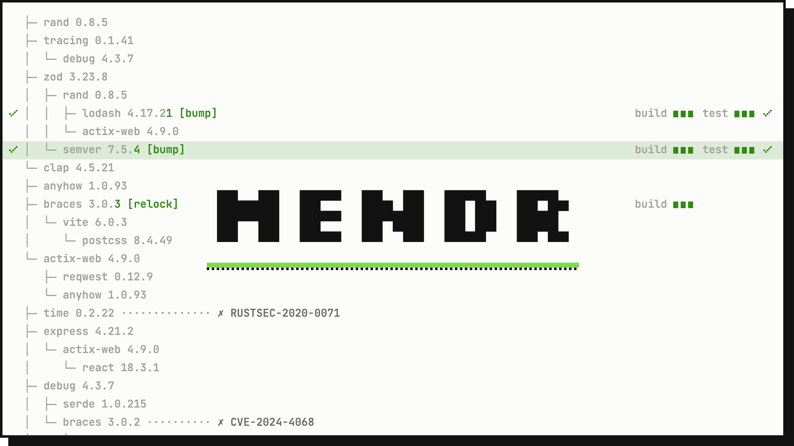

<picture>
  <source media="(prefers-color-scheme: dark)" srcset="docs/banner-dark.gif">
  
</picture>

# mendr

mendr finds known vulnerabilities in a project's dependencies (via [OSV](https://osv.dev)) and
fixes them the way a developer would, following your policy: which fix strategies to use and in
which order, and whether to move to the smallest fixed version or the latest compatible one.
When the vulnerable package is a transitive dependency, it updates the direct dependency that
pulls it in. Every fix is verified in a temporary copy of the project (it must still build and
pass the tests), and every finding ends with a result and a reason.

mendr never touches your checkout unless you pass `--write`.

## How it fixes

For each vulnerable package version, mendr tries the strategies listed in
`[policy] strategies`, in that order, and plans the first one that can fix it within the policy.
By default all three are enabled, cheapest first:

1. **relock**: only the lockfile changes. The parent's declared range already allows a fixed
   version (`cargo update -p smallvec@1.6.0 --precise 1.6.1`, npm re-resolving that copy, or
   pnpm pinning it for one resolution).
2. **direct bump**: raise the requirement of the direct dependency in your manifest to a
   version that pulls in a fix (`tempfile = "3.3.0"` -> `"3.4.0"`), keeping the range style.
3. **override**: force the fixed version through the package manager's override mechanism
   (npm `overrides`, scoped to the vulnerable versions; pnpm `overrides` in
   `pnpm-workspace.yaml`, scoped to the packages that depend on the vulnerable version; Gradle
   `constraints {}` in the projects that lock the vulnerable version). Not available for Cargo.
4. **give up with a reason**: e.g. `no_patched_version`, `no_parent_version_fixes`,
   `major_bump_blocked`, `release_too_recent`.

Leave a strategy out to never use it, e.g. `strategies = ["direct-bump"]` to only bump direct
dependencies, or `["override", "direct-bump"]` to prefer overrides. If the planned change then
fails verification, it is reported as failed; mendr does not fall back to the next strategy.

`[policy] target` picks the version among those that fix the finding:

- `minimal` (default): the smallest one (`tempfile` 3.3.0 -> 3.4.0);
- `latest-compatible`: the highest one that is not a major bump from the smallest one
  (`tempfile` 3.3.0 -> the newest 3.x, not 4.x), to update further while you are at it.

Fix versions must be unaffected by every known advisory for the package, not yanked, not
prereleases, and older than `min-release-age`. Major bumps are off unless allowed.

Then, unless `--plan-only`, mendr copies the project to a temp dir and:

- runs a **baseline** install/build/test; if the project is already broken, nothing is attempted
  (`baseline_failed`);
- applies the changes one by one on top of each other: apply, re-resolve the graph, check that
  every new package version is old enough, rescan (the finding must be gone and no new
  vulnerability may appear), then install, build and test. A change that fails is reverted and
  reported (`build_failed`, `test_failed`, `still_vulnerable`, ...); the others continue;
- with `--write`, copies only the manifest and lockfile edits of the kept changes back into the
  project.

## Install and run

Toolchains come from the Nix flake (Rust, Node 22, pnpm, Gradle, JDK 21):

```sh
nix develop                  # shell with cargo, node, npm, pnpm, gradle, java
cargo install --path .       # or: cargo build --release && ./target/release/mendr
```

Run it in the project directory (or point `--config` at a `mendr.toml`):

```sh
mendr --plan-only                       # scan and plan, build nothing (JSON on stdout)
mendr --format markdown                 # plan, verify every fix, print a Markdown report
mendr --write                           # ... and apply the verified changes to the project
mendr --format markdown --output report.md
```

Progress goes to stderr, the report to stdout (or `--output`). Each finished
step prints one line; on a terminal the step in progress also shows a spinner,
the elapsed time and the current request or command:

```text
    Scanning . (npm)
    Resolved 9 dependencies (0.0s)
     Checked 9 packages against OSV (2.4s)
     Planned 1 change for 2 findings (0.5s)
    Baseline passed (0.7s)
        Kept override path-to-regexp 0.1.7 → 0.1.13 (0.9s)
    Finished 2 findings: 2 fixed (4.4s)
```

`--quiet` keeps only warnings and errors; `NO_COLOR` turns off colors.

### Flags

| flag | meaning |
|------|---------|
| `--config <PATH>` | config file (default: `./mendr.toml` if present) |
| `--plan-only` | only plan fixes; no build, no test |
| `--format json\|markdown` | report format (default `json`) |
| `--output <FILE>` | write the report to a file instead of stdout |
| `--osv-snapshot <DIR>` | read OSV records from `DIR/*.json` (one record per file, osv.dev schema) instead of the live API |
| `--allow-major` | allow major version bumps (`[policy] allow-major`) |
| `--min-release-age <DUR>` | minimum age of any version mendr picks: `"7d"`, `"12h"`, `"20m"`, `"30s"`, `"0"` = off (`[policy] min-release-age`, default `7d`) |
| `-q`, `--quiet` | print only warnings and errors on stderr |
| `--write` | copy verified manifest/lockfile changes back into the project (not with `--plan-only`) |

## Configuration: `mendr.toml`

Optional. Without it mendr uses the defaults below and one auto-detected project in the current
directory. Unknown keys are rejected. Paths are relative to the config file.

```toml
[policy]
strategies = ["relock", "direct-bump", "override"]  # enabled strategies, in order of preference
allow-major = false          # allow major bumps of direct dependencies / overrides
min-release-age = "7d"       # "0" disables; versions without a known publish date count as too new
min-severity = "low"         # low | medium | high | critical; unknown severity always passes
target = "minimal"           # smallest fixed version, or "latest-compatible": highest one without another major bump

[npm]                        # npm projects; both keys optional
registry = "https://registry.npmjs.org/"  # http(s) URL
replace-registry-host = "always"          # npmjs | always | never | a host name

[osv]
api = "https://osv.intern.example/v1"     # optional OSV API base URL (http(s))

[[project]]                  # repeatable; default: one project at "."
path = "services/api"        # ecosystem auto-detected
timeout = "20m"              # per command; default and "0": no timeout

[[project]]
path = "apps/web"
ecosystem = "npm"            # optional: cargo | npm | pnpm | gradle
install = "npm ci --ignore-scripts"   # override the default commands per step
build = "npm run build"
test = "npm test"

[[ignore]]
id = "GHSA-xxxx-yyyy-zzzz"   # the advisory id or any alias (CVE, RUSTSEC, ...), any case;
                             # mendr warns when it matches no advisory of the scanned packages
reason = "not reachable: we never parse untrusted input"
expires = 2026-12-31         # optional, inclusive (UTC); afterwards the advisory counts again
```

`[npm]` and `[osv]` values win over the environment; a key that is not set falls back to it:

| key | used for | fallback |
|-----|----------|----------|
| `npm.registry` | mendr's registry lookups and npm's `registry` | `$npm_config_registry`, `$NPM_CONFIG_REGISTRY`, then `https://registry.npmjs.org/` |
| `npm.replace-registry-host` | npm's `replace-registry-host` | `$npm_config_replace_registry_host`, then npm's default (`npmjs`) |
| `osv.api` | OSV API base URL | `$MENDR_OSV_API` (if not empty), then `https://api.osv.dev/v1` |

Configured `[npm]` keys are passed to every npm process mendr starts as `npm_config_registry` /
`npm_config_replace_registry_host` (replacing an upper-case `NPM_CONFIG_*` spelling): the
`npm install --package-lock-only` that applies a change and the install, build and test commands,
including commands set in `[[project]]` (they run through `sh`, so any `npm` they call sees them).
Example: a `package-lock.json` whose `resolved` URLs point at a company
registry can be installed from the public one with `registry = "https://registry.npmjs.org/"`
and `replace-registry-host = "always"` (npm then ignores the host in `resolved`).

`mendr.toml` holds no credentials and has no token key. Registry tokens still come from an
`.npmrc` outside the project or from environment variables.

Default commands:

| ecosystem | install | build | test |
|-----------|---------|-------|------|
| cargo | - | `cargo build --locked --all-targets` | `cargo test --locked` |
| npm | `npm ci --no-audit --no-fund` | `npm run build` if `scripts.build` exists | `npm test` if a real `scripts.test` exists |
| pnpm | `pnpm install --frozen-lockfile` | `pnpm run build` if `scripts.build` exists | `pnpm test` if a real `scripts.test` exists |
| gradle | - | `./gradlew assemble --no-daemon --console=plain` (`gradle` without a wrapper) | `./gradlew test --no-daemon --console=plain` |

## What verification runs

Verification runs untrusted code (build scripts, install scripts and test suites of new
dependency versions) with your user's permissions and environment. mendr does not isolate it
itself; run it in a sandbox. We recommend [MXC](https://github.com/microsoft/mxc): on macOS it
sandboxes mendr and everything it starts without root or a daemon.
[`examples/mxc/`](examples/mxc/README.md) has ready policies for an npm and a Rust project that
block everything except the project, the toolchain and a scratch directory (no access to `~/.ssh`,
`~/.aws`, other repositories or the host environment):

```sh
mkdir -p ~/.mendr-sandbox/tmp
mxc-exec-mac examples/mxc/npm.json > report.md   # after adjusting the paths in the policy
```

Other options: a container, a VM, a CI job without secrets, or `--plan-only` (runs no project
code).

The temp copy leaves out `.git` and every `node_modules`. Commands run in their own process
group, which is killed when the command ends (no background process survives it). On Ctrl-C,
`SIGTERM` or `SIGHUP` mendr stops the running command, removes the temp copy and exits with
128 + the signal number (130, 143, 129); a second signal exits at once. `--write` refuses to
touch the project if a file it would write changed since mendr copied it, and replaces files by
renaming temp files written next to them.

## Output and exit codes

- `--format json` (default): machine-readable report. The shape (`schema_version` 1) is
  documented at the top of [`src/report.rs`](src/report.rs). Each finding is one advisory x one
  vulnerable package version x one direct dependency it is reached through, with its planned
  `change` and its `outcome`:
  `planned`, `fixed`, `skipped` (with a reason) or `failed` (with a reason, exit code and log tail).
- `--format markdown`: summary table, changes, findings and details with log tails; meant for a
  PR description.

| exit code | meaning |
|-----------|---------|
| 0 | no unresolved findings: every finding is `fixed`, `planned` (`--plan-only`), `skipped:ignored` or `skipped:below_min_severity` |
| 1 | unresolved findings remain |
| 2 | error (bad config, a project could not be processed) |

## Supported ecosystems

| ecosystem | detected by | strategies |
|-----------|-------------|------------|
| Cargo | `Cargo.toml` + `Cargo.lock` | relock, direct bump (incl. `[workspace.dependencies]`) |
| npm | `package.json` + `package-lock.json` (v2/v3) or `npm-shrinkwrap.json` | relock, direct bump, override (incl. workspaces) |
| pnpm | `package.json` + `pnpm-lock.yaml` (v9) | relock, direct bump, override (incl. workspaces) |
| Gradle | `settings.gradle(.kts)` or `build.gradle(.kts)` + a `gradle.lockfile` (dependency locking) | direct bump (build scripts, version catalogs, `gradle.properties`), override (`constraints {}`) |

Limitations:

- A committed lockfile is required.
- Cargo: only crates.io packages are scanned and changed (git, path and alternative-registry
  dependencies are not); there is no override. Stable Cargo cannot resolve by publish date, so
  the release-age check on the resulting lockfile is the only guard for new transitive versions.
  Path dependencies outside the project directory are missing in the temp copy; point
  `[[project]] path` at the workspace root.
- npm: the registry is `[npm] registry`, `$npm_config_registry` or the public one (see
  [Configuration](#configuration-mendrtoml)); `.npmrc` files are not read by mendr (npm itself
  still reads them). Bundled dependencies are not scanned.
- pnpm: changes need pnpm >= 10 (lockfiles from pnpm 9 are read). The registry is
  `$pnpm_config_registry`, `$npm_config_registry` or the public one (`[npm]` does not apply);
  `.npmrc` and
  `pnpm-workspace.yaml` settings are not read. Dependencies declared through a pnpm catalog
  (`catalog:`) are not bumped (`manifest_not_editable`). The lockfile does not record the ranges
  that registry packages declare, so they are fetched once per package version from the registry
  (and cached). A project that has both `package-lock.json` and `pnpm-lock.yaml` is detected as
  npm; set `ecosystem = "pnpm"` to choose pnpm.
- Gradle: the build must use [dependency locking](https://docs.gradle.org/current/userguide/dependency_locking.html):
  add `dependencyLocking { lockAllConfigurations() }` to every project and run
  `./gradlew dependencies --write-locks` once. The lockfile has no dependency tree, so mendr
  rebuilds it from the build's declarations and each locked version's POM (from
  [deps.dev](https://deps.dev), which covers Maven Central; modules from other repositories
  are scanned but get no edges). A change rewrites the lockfiles with
  `gradle dependencies --write-locks`, which runs the build scripts, so it happens only during
  verification. A dependency declared without a version (managed by a
  platform/BOM or a plugin) is fixed with an override, not by bumping the BOM. Plugin
  classpaths (`buildscript-gradle.lockfile`) are not scanned; there is no relock.
- Not supported yet: yarn lockfiles, Go, Flutter/Dart (planned, see [PLAN.md](PLAN.md)).

OSV responses and registry metadata are cached under `$MENDR_CACHE_DIR`,
`$XDG_CACHE_HOME/mendr` or `~/.cache/mendr` (empty variables are ignored; without `HOME`, a
`mendr-<uid>` directory in the system temp directory). Entries unused for 30 days are deleted at
startup. Failed requests (connection errors, timeouts, HTTP 408, 429 and 5xx) are retried three
times with backoff. `[osv] api` or `MENDR_OSV_API` replaces the OSV API base URL (default
`https://api.osv.dev/v1`), e.g. with a mirror.

## Development

```sh
nix develop -c cargo fmt --check
nix develop -c cargo clippy --all-targets -- -D warnings
nix develop -c cargo test                                   # unit tests, offline
nix develop -c cargo test --test fixtures -- --ignored      # end to end, needs network
MENDR_FIXTURE=npm/override nix develop -c cargo test --test fixtures -- --ignored
```

The fixtures in [`test-projects/`](test-projects/README.md) are small real projects with known
vulnerable dependencies, one directory per scenario (relock, direct bump, override, no fix, a fix
that breaks the build or the tests, a broken baseline, a two-project `mendr.toml`), each with its
lockfile, a frozen OSV snapshot and an `expected.json`. The harness runs the `mendr` binary in an
isolated environment (empty `HOME`, cleared env).

### Adding an ecosystem

Implement the `Ecosystem` trait in [`src/ecosystem/mod.rs`](src/ecosystem/mod.rs) (detection,
version semantics, graph resolution from manifest + lockfile, `apply` for each supported
strategy, default commands, registry lookups) in `src/ecosystem/<name>.rs`, then register it in
the two places marked in that file. Planning, verification and reporting are
ecosystem-agnostic. `src/ecosystem/cargo.rs` is a compact example; the fake ecosystem in
`src/ecosystem/fake.rs` shows the contract in unit tests. Add fixtures under
`test-projects/<name>/`.
